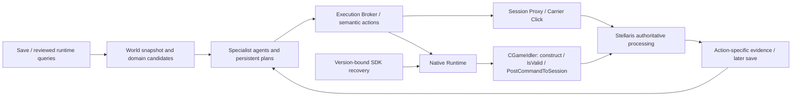

<!-- SPDX-FileCopyrightText: 2026 Nostalgia and Imperial Auto Governor contributors -->
<!-- SPDX-License-Identifier: CC-BY-SA-4.0 -->

# OGAS

**English | [简体中文](README.zh-CN.md)**

Specialist AI agents for sustained empire governance in **Stellaris**.

OGAS connects game-state observation, domain-specific agents, persistent plans,
and guarded execution. The aim is an AI partner that can keep governing an
empire over a campaign, explain its decisions, and demonstrate what actually
happened, rather than merely suggest actions in a chat window.

**Current version: `v0.6.0-alpha.1`** (`0.6.0a1` in Python). This is a source
alpha and research checkpoint, not a turnkey release for the latest game.
There are no new installers or GitHub Release assets for this tag.

## What It Can Do

| Area | Implemented capabilities | Important boundary |
| --- | --- | --- |
| Economy and construction | Read colonies, generate legal construction candidates, plan buildings/districts/zones and reserve spending | Execution is limited to reviewed actions and supported game builds |
| Research | Separate research agent, current tasks and alternatives, prepare/execute workflow and evidence tracking | Native legality tests do not prove actual technology selection |
| Fleets and expansion | Fleet permissions, movement/combat planning, repair/upgrade, civilian automation, colonization, starbases, ship designs and reinforcement workflows | Coverage varies by backend and exact build; captured commands are not automatically enabled tools |
| Long-term coordination | Private application histories, persistent plan books, local fact checks, bounded replanning and deterministic save continuations | Side effects are serialized; ordered sequences do not promise rollback |
| Player interaction | Web console and optional Qt overlay with application-specific conversations | Native in-game chat is a separate, build-specific research prototype |
| Native execution research | Typed action modules, game-thread command construction, native `IsValid`, session submission and postcondition interfaces | Current 4.5.2 native actions remain gated pending execution evidence |
| SDK and performance research | Linux symbol/serializer recovery, Windows matching, candidate planning, batch legality probes, long-running Observe capture and CPU flame graphs | Discovery, offline construction, legality and execution are separate evidence levels |

Economy, research and fleet agents have separate tools, histories and model
bindings. They share observations and execution safeguards, not unrestricted
authority over one another. `etc` stages unclassified capabilities; it is not
an autonomous catch-all agent.

Autonomous governance of multiple AI empires, including games alongside human
players, is a **development direction**. Observer-country experiments establish
parts of that route, not a finished multi-empire product.

## How It Works



Applications express intent, not opcodes, packet framing or hook addresses.
The Broker checks contracts, capabilities, authority, candidates and snapshot
freshness. Native backends reuse the game's command/session pipeline; Session
Proxy and Carrier Click retain their separate verified transport logic. Some
economy/fleet callers still have explicitly allowlisted legacy dependencies
during the Broker migration.

The engineering choices are concrete: strict targets and bounded candidates;
exact binary fingerprints and SDK metadata; execution on the game thread;
resource reservations; correlated request identities; persistent plans; and
confirmation from backend evidence or a subsequent save. `IsValid=true` alone
never means an action executed successfully.

## Maturity and Evidence

- **Historical execution evidence:** Stellaris 4.4.6 has recorded Session Proxy,
  Carrier Click and selected Linux/Windows native execution trials. Results do
  not automatically transfer to 4.5.2 or every mod.
- **4.5.2 native legality research:** documented cumulative Linux trials
  constructed 310 distinct Command classes, populated and called `IsValid` for
  174, and found a true candidate for 105. These were non-submitting probes,
  not 105 production actions.
- **Offline recovery:** the catalog contains 351 Linux Commands. The latest
  coordinate/constraint codec preflight accepts 166 types / 2,548 candidate
  plans. Neither number describes live execution coverage.
- **Still experimental:** current-build native execution admission, complete
  Broker migration, broader legal-parameter generation, mod rule interpretation
  and general multi-empire governance.

Read the [alpha notes](docs/releases/v0.6.0-alpha.1.md),
[4.5.2 acceptance record](docs/runtime/PRODUCER_VALIDATION_ACCEPTANCE_4_5_2.md)
and [research evidence access guide](docs/research/EVIDENCE_ARCHIVE.md).
The archive distinguishes public originals, redacted derivatives and withheld
originals. Missing provenance is marked unknown, not reconstructed as fact.

## Get Started From Source

Use Python 3.11+ and your own legal Stellaris installation. Game binaries,
saves, private configuration and credentials are not included.

```bash
git clone https://github.com/V2t-Nostalgia/OGAS.git
cd OGAS
python -m venv .venv
# Activate .venv for your shell, then:
python -m pip install -e .
python -m apps.control_center.web_console --help
python scripts/validation/run_tests.py --quiet
```

Start with [Development](docs/DEVELOPMENT.md), then the
[control console](apps/control_center/README.md) and
[host bridge](apps/host_bridge/README.md). Linux packet support requires system
dependencies; read the deployment notes before installation. The optional
overlay uses `python -m pip install -e ".[overlay]"` and
`python -m apps.game_overlay.main --preview`.

Do not load a native probe just to explore the source. Exact game version,
platform, verification level and a separately authorized disposable session
are prerequisites for live research. Never replay a historical capture into
another session.

## Explore and Contribute

- [Architecture](docs/ARCHITECTURE.md) and [Execution Broker](docs/EXECUTION_BROKER.md)
- [Native Runtime](services/stellaris_native_runtime/README.md) and [action contributions](docs/runtime/NATIVE_RUNTIME_ACTION_CONTRIBUTING.md)
- [SDK recovery](services/stellaris_native_runtime/tools/sdk_recovery/README.md) and [candidate research](services/stellaris_native_runtime/tools/script_candidates/README.md)
- [Observe and profiling](docs/runtime/OBSERVE_PERFORMANCE_MOD_ANALYSIS.md)
- [File index](docs/code-map/FILE_INDEX.md), [contribution guide](CONTRIBUTING.md), [security policy](SECURITY.md)

Independent audits, reproducible bug reports and better automated recovery
methods are welcome, including findings that contradict existing conclusions.

## License and History

Code is **GPL-3.0-only**; original documentation is **CC-BY-SA-4.0**. Third-party
MIT components retain their notices. See [NOTICE](NOTICE), [LICENSES](LICENSES),
[DCO](DCO) and [origin](ORIGIN.md). OGAS is unofficial and is not endorsed by
Paradox Interactive or other named vendors.

The project was previously named **Imperial Auto Governor**. Stable `iag`
imports, protocol identifiers and configuration locations are intentionally
retained. The detailed
[v0.5.10 overview](https://github.com/V2t-Nostalgia/OGAS/blob/v0.5.10/README.md)
and [version notes](docs/releases/v0.5.10.md) remain historical references.
