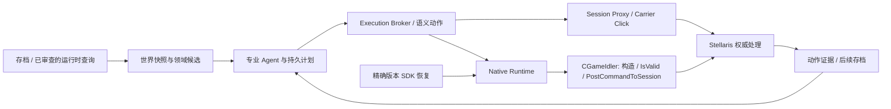

<!-- SPDX-FileCopyrightText: 2026 Nostalgia and Imperial Auto Governor contributors -->
<!-- SPDX-License-Identifier: CC-BY-SA-4.0 -->

# OGAS

**[English](README.md) | 简体中文**

为 **Stellaris（群星）**提供持续帝国治理能力的专业 AI Agent 平台。

OGAS 将游戏状态观察、领域 Agent、持久计划与受控执行连接起来。目标是让 AI
在整场战役中持续治理帝国、解释决策，并用证据说明实际发生了什么，而不仅是在
聊天窗口里给出操作建议。

**当前版本：`v0.6.0-alpha.1`**，Python 版本为 `0.6.0a1`。这是源码 alpha 与研究
检查点，不是面向最新游戏版本的即装即用发行版。该 Tag 不提供新的安装包或
GitHub Release 附件。

## 已实现的能力

| 领域 | 已有实现 | 必须注意的边界 |
| --- | --- | --- |
| 经济与建设 | 读取殖民地、生成合法建设候选、规划建筑/区划/区域并预留支出 | 执行仅限经过审查的动作与支持的精确游戏构建 |
| 科研 | 独立科研 Agent、当前任务与备选科技、准备/执行流程及证据跟踪 | 原生合法性测试不等于科技已实际选中 |
| 舰队与扩张 | 逐舰队授权、移动和作战规划、维修升级、民用船自动化、殖民、恒星基地、舰船设计与增援 | 覆盖取决于 backend 和精确版本；捕获到的命令不一定是已启用工具 |
| 长期协调 | 独立 Application 历史、持久计划书、本地事实检查、有界重规划和确定性存档续接 | 游戏副作用串行执行；有序序列不承诺失败回滚 |
| 玩家交互 | Web 控制台与可选 Qt 叠加层，按 Application 隔离对话 | 原生游戏内聊天仍是独立、绑定版本的研究原型 |
| 原生执行研究 | 类型化动作模块、游戏线程构造、原生 `IsValid`、session 提交及后置条件接口 | 当前 4.5.2 原生动作仍受执行证据准入限制 |
| SDK 与性能研究 | Linux 符号/序列化器恢复、Windows 匹配、候选规划、批量合法性探测、长期 Observe 捕获与 CPU 火焰图 | 发现、离线构造、合法性与执行是不同证据等级 |

经济、科研和舰队 Agent 拥有独立工具、历史与模型绑定；共享观察和执行安全边界，
而不是任意接管其他 Agent 的权限。`etc` 用于暂存尚未归类的能力，不是一个拥有
所有权限的自主 Agent。

在同一游戏中自主治理多个 AI 帝国、并与人类玩家共同参与，是**发展方向**。
观察者国家实验验证了其中部分链路，不代表完整的多帝国产品已经完成。

## 技术体系



Application 表达行动意图，不负责 opcode、网络分帧或 Hook 地址。Broker 检查契约、
能力、权限、候选和快照新鲜度。Native backend 复用游戏自身的 Command/session
链；Session Proxy 与 Carrier Click 保留各自经过验证的传输实现。经济与舰队的
部分旧调用仍处在明确 allowlist 保护的 Broker 渐进迁移中。

值得关注的是已有证据支撑的工程机制：严格 target、有界候选、精确二进制指纹
与 SDK 元数据、游戏线程执行、资源预留、请求身份关联、持久计划，以及 backend
证据或后续存档确认。`IsValid=true` 本身从不代表动作已经执行成功。

## 成熟度与证据

- **历史执行实证：**4.4.6 已记录 Session Proxy、Carrier Click 及部分 Linux/Windows
  原生执行实验；不能直接外推为 4.5.2 或所有 Mod 已兼容。
- **4.5.2 原生合法性研究：**已记录的 Linux 累计实验构造过 310 种 Command，
  对 174 种完成填参和 `IsValid`，105 种至少有一个 true 候选。这些是不提交命令的
  研究探测，不是 105 个生产动作。
- **离线恢复：**目录包含 351 种 Linux Command；最新坐标/constraint codec 预检
  接受 166 种、2,548 份候选计划。这两个数字都不是实机执行覆盖率。
- **仍在研究：**当前版本原生执行准入、完整 Broker 迁移、更广泛的合法参数生成、
  Mod 规则解释，以及通用多帝国自主治理。

详见 [alpha 说明](docs/releases/v0.6.0-alpha.1.md)、
[4.5.2 验收记录](docs/runtime/PRODUCER_VALIDATION_ACCEPTANCE_4_5_2.md)与
[研究证据访问指南](docs/research/EVIDENCE_ARCHIVE.md)。归档区分公开原件、脱敏副本
和受限原件；缺失的来源关系标为未知，不补写成事实。

## 从源码开始

需要 Python 3.11+，以及自行合法安装的 Stellaris。仓库不附带游戏二进制、存档、
私人配置和凭据。

```bash
git clone https://github.com/V2t-Nostalgia/OGAS.git
cd OGAS
python -m venv .venv
# 按所用 shell 激活 .venv，然后：
python -m pip install -e .
python -m apps.control_center.web_console --help
python scripts/validation/run_tests.py --quiet
```

先阅读[开发指南](docs/DEVELOPMENT.zh-CN.md)，再查看
[控制台](apps/control_center/README.md)和[房主桥](apps/host_bridge/README.md)。
Linux 抓包能力需要系统依赖，安装前请阅读部署说明。可选叠加层安装命令为
`python -m pip install -e ".[overlay]"`，预览入口为
`python -m apps.game_overlay.main --preview`。

不要为了阅读源码而直接加载原生探针。实机研究必须匹配精确版本、平台、验证
等级，并单独取得可丢弃会话授权。不得把历史抓包直接重放到另一个游戏会话。

## 阅读与贡献

- [架构](docs/ARCHITECTURE.md)与 [Execution Broker](docs/EXECUTION_BROKER.md)
- [Native Runtime](services/stellaris_native_runtime/README.md)与[原生动作贡献](docs/runtime/NATIVE_RUNTIME_ACTION_CONTRIBUTING.md)
- [SDK 恢复](services/stellaris_native_runtime/tools/sdk_recovery/README.md)与[候选研究](services/stellaris_native_runtime/tools/script_candidates/README.md)
- [Observe 与性能分析](docs/runtime/OBSERVE_PERFORMANCE_MOD_ANALYSIS.md)
- [文件索引](docs/code-map/FILE_INDEX.md)、[贡献指南](CONTRIBUTING.zh-CN.md)、[安全政策](SECURITY.md)

欢迎独立审计、可复现的缺陷报告和更高效的自动恢复方法，包括能够推翻现有结论的证据。

## 许可与历史

代码采用 **GPL-3.0-only**，原创文档采用 **CC-BY-SA-4.0**；第三方 MIT 组件保留
各自声明。详见 [NOTICE](NOTICE)、[许可证](LICENSES)、[DCO](DCO)及[项目起源](ORIGIN.md)。
项目独立、非官方，不代表 Paradox Interactive 或其他厂商背书。

项目历史名称为 **Imperial Auto Governor**。稳定的 `iag` 导入、协议标识和配置
位置有意保留。原有详尽的
[v0.5.10 项目说明](https://github.com/V2t-Nostalgia/OGAS/blob/v0.5.10/README.md)及
[版本记录](docs/releases/v0.5.10.md)继续作为历史参考。
